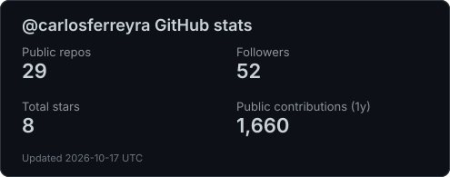
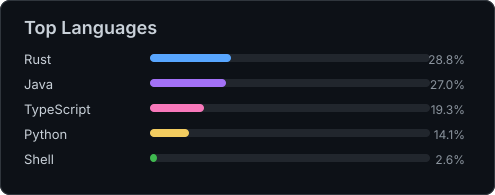
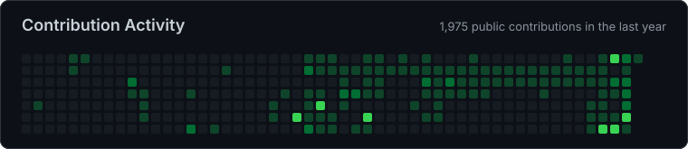

# Carlos Ferreyra

**Software Engineer · Backend services · Developer tools · Automation**

I build APIs, automate workflows, and work with data using Python and Rust.

[Portfolio](https://carlosferreyra.com.ar) · [LinkedIn](https://linkedin.com/in/eduferreyraok) · [Email](mailto:contact@carlosferreyra.com.ar) · [Résumé · EN](resume/carlos-ferreyra.pdf) / [ES](resume/carlos-ferreyra-espanol.pdf)

---

## Selected projects

### [awesome-uvx](https://github.com/carlosferreyra/awesome-uvx)

A curated collection of Python CLI tools available via uvx or pipx.

`Python` · [Source](https://github.com/carlosferreyra/awesome-uvx) · [Website](https://carlosferreyra.github.io/awesome-uvx/)
### [wsr](https://github.com/ectorial/wsr)

A pre-alpha local CI runner scaffold; workflow execution and sandboxing are planned

`Rust` · [Source](https://github.com/ectorial/wsr) · [Website](https://ectorial.github.io/wsr/)
### [informatorio](https://github.com/informatorioar/informatorio)

Curso Informatorio - Edicion 2025

`Python` · [Source](https://github.com/informatorioar/informatorio) · [Website](https://informatorioar.github.io/informatorio/)
### [codetwin](https://github.com/carlosferreyra/codetwin)

A code to diagram/documentation generator.

`Rust` · [Source](https://github.com/carlosferreyra/codetwin) · [Website](https://carlosferreyra.github.io/codetwin/)

More projects

- [**business-card**](https://github.com/carlosferreyra/business-card) — Interactive CLI business card available in both Python and TypeScript - run with uvx or npx
- [**profilectl**](https://github.com/carlosferreyra/profilectl) — Cross-platform dotfiles automation with Rust

## Currently building

- 🔭 Working on: [wsr](https://github.com/ectorial/wsr) & [awesome-uvx](https://github.com/carlosferreyra/awesome-uvx)

## Toolkit

- **Languages:** Python · Java · JavaScript · TypeScript · Rust
- **Cloud:** GCP · AWS
- **Databases:** MySQL · MongoDB · SQLite
- **DevOps & Infra:** Docker · CI/CD · GitHub Actions · Git · Linux
- **Frameworks:** Django+DRF · Angular · Spring · FastAPI
- **IT Operations:** Process automation · Workflow mapping · DBA fundamentals · CI/CD pipelines · Data processing · Data lakehouse

## Experience highlights

**Software Engineer · UTN - FRRe** 
March 2024 - Dec 2024

- Worked in a team of 6+ people building an ED Platform that helped automate tasks, optimize processes, and maximize productivity
- Mapped manual processes with non-technical stakeholders, documented constraints, and helped reduce costs 10% while increasing efficiency 50%.

**Backend Engineer · Devlights S.R.L** 
March 2021 - Sep 2021

- Collaborated with a team of 4+ interns and mentors to develop a website for an ISP company
- Implemented a REST-API to automate data collection of the customer

Education & certifications

### Education

**Information Systems Engineering** · Universidad Tecnologica Nacional, Argentina 
2015 - 2024

- Relevant coursework: Data Structures, Algorithms, Software Engineering, Databases

### Certifications

- [Databricks Data Engineer Associate · 2025](https://credentials.databricks.com/profile/carlosferreyra/wallet)
- [SQL Advanced · 2025](https://www.kaggle.com/learn/certification/eduferreyraok/advanced-sql)
- [MongoDB - Database Administration · 2025](https://learn.mongodb.com/c/OE3lXL2WRfa33hpCBtCwEQ)
- [Oracle Next Education Program · 2025](https://app.aluracursos.com/program/certificate/4fd8c5a8-9a27-4d31-b4e5-0ddc4a739e51)
- [Amazon Cloud Practitioner Essentials · 2024](https://drive.google.com/file/d/1NqapZG2uenlclXVaJOKurjd5H_WZNHMW/view)
- [Google Associate Cloud Engineer · 2024](https://www.credly.com/badges/6347777b-1952-426b-95f0-daadbaccf8e0/linked_in_profile)

GitHub activity & languages

  
  

  

---

Open to opportunities in backend development, developer tooling, and automation. [Let's talk.](mailto:contact@carlosferreyra.com.ar)

Last synced: 2026-10-23 21:27 UTC
